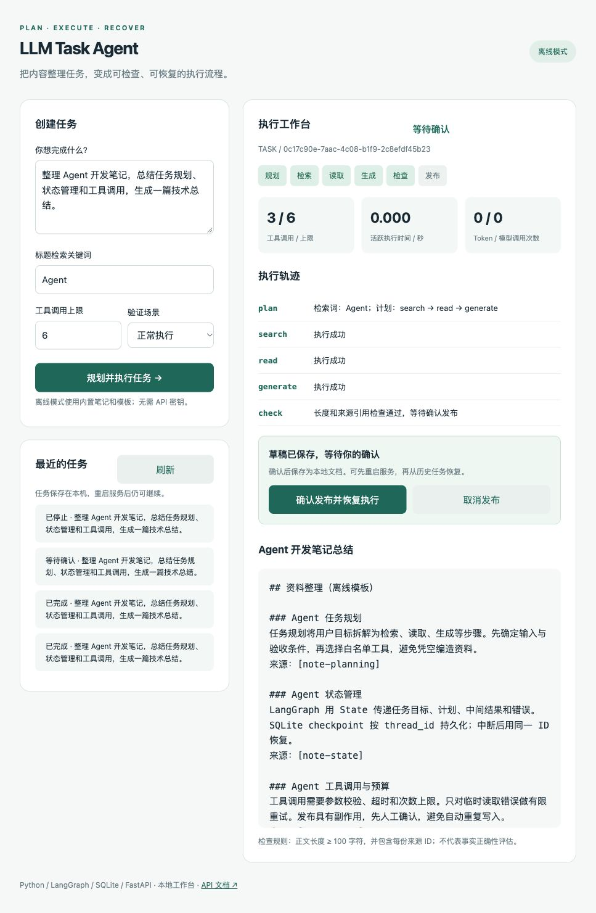
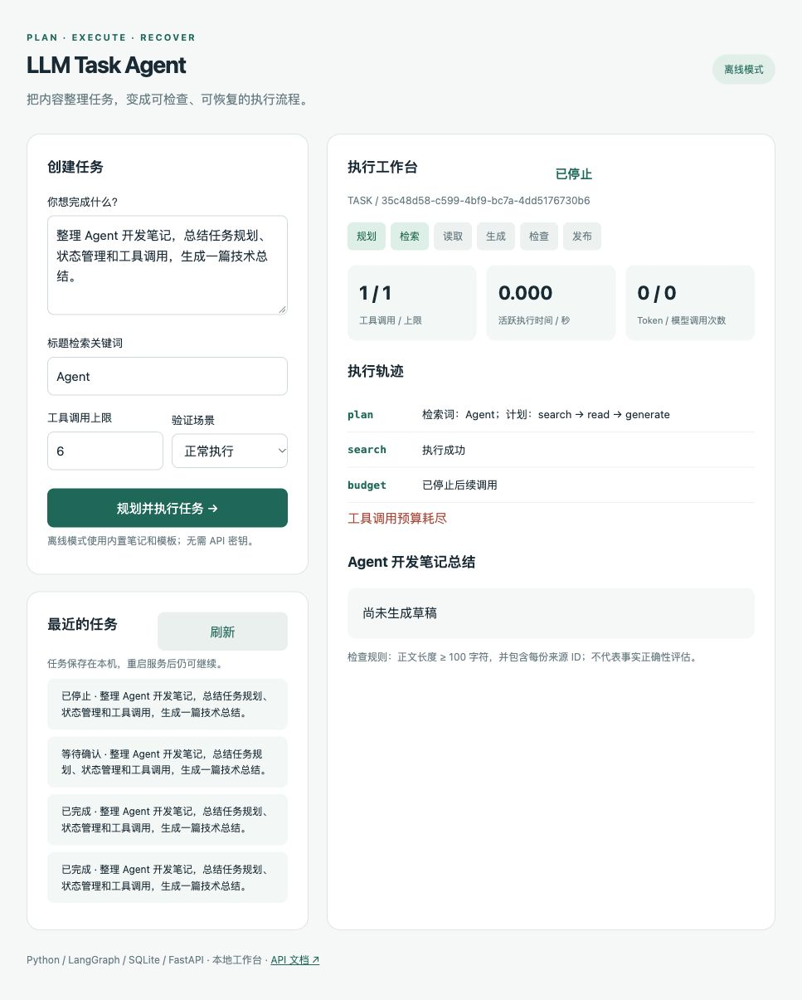
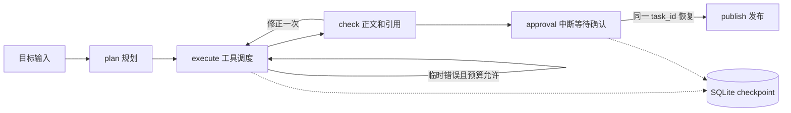
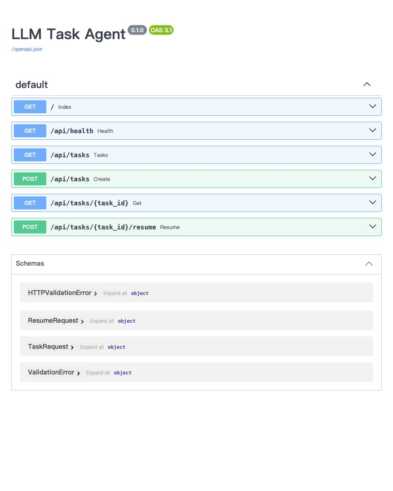

# LLM Task Agent

基于 **Python / LangGraph / FastAPI / SQLite** 的内容整理 Agent 原型，提供可视化工作台、RESTful API、持久化检查点、发布前中断恢复、有限重试和固定场景评测。

默认离线模式无需密钥，使用内置笔记与固定模板。真实模式接入支持工具调用的 LLM API 和 Notion API，代码及模拟 HTTP 契约测试已完成，尚未使用真实账号联调。不能把离线运行结果当作真实模型能力或线上效果。

## 工作台预览

输入内容整理目标后，工作台集中展示任务计划、执行轨迹、草稿与发布结果。下图是离线模式的一次完整执行，输出保存为本地文档。


- **执行轨迹**：逐步展示规划、检索、读取、生成、检查和发布，便于定位失败环节。
- **调用指标**：查看工具调用次数与上限、活跃执行耗时、Token 与模型调用量。离线模式不调用模型，因此 Token 与模型调用量为 0。
- **来源草稿**：查看整理结果及来源 ID，再决定是否发布。

## 快速运行

需要 Python 3.12。首次安装依赖需要网络。

```bash
python3.12 -m venv .venv
source .venv/bin/activate
pip install -r requirements.lock.txt
python -m uvicorn app.main:app --host 127.0.0.1 --port 8000
```

打开 [演示工作台](http://127.0.0.1:8000)，API 文档位于 [Swagger UI](http://127.0.0.1:8000/docs)。当前交付目录已安装依赖，可直接使用 `.venv/bin/python` 启动。

## 三分钟演示

1. 保持默认任务和检索词 `Agent`，点击“规划并执行任务”。
2. 展示规划、检索、读取、生成与检查的执行轨迹，以及工具调用计数。此时草稿已保存，发布尚未执行。
3. 停止服务并使用相同命令重启。刷新页面，在“最近的任务”中选择等待确认的任务，展示恢复出的草稿。
4. 点击“确认发布并恢复执行”，任务完成。离线模式保存到本地 SQLite 演示文档表，不会写入 Notion。
5. 选择“首次检索超时”，创建新任务，展示一次重试；选择“首次草稿不合格”，展示检查后的有限修正。
6. 把工具调用上限改为 `1`，展示预算耗尽后停止执行；检索词改为不存在的主题，展示无资料时停止而不生成内容。

### 发布前确认与恢复

生成草稿并通过检查后，任务停在“等待确认”状态。此时调用计数为 `3 / 6`，发布尚未执行；状态已保存到 SQLite。重启服务后可从历史任务重新打开，再确认发布并继续执行。

<details>
<summary>查看发布前确认界面</summary>



</details>

### 调用预算限制

将工具调用上限设为 `1` 后，任务只完成一次检索，随后停止。轨迹中显示 `budget` 节点和“工具调用预算耗尽”，后续读取、生成与发布均不会执行。

<details>
<summary>查看预算耗尽后的停止状态</summary>



</details>

以上均为本地离线模式的实际截图。截图展示工作流行为，真实 LLM / Notion 账号联调仍待完成。

详细讲解见 [使用与架构说明](DEMO_GUIDE.md)。

## 实现范围

| 功能 | 当前实现 |
| --- | --- |
| 任务规划 | 离线模式固定计划；真实模式通过 LLM function calling 提交关键词、标题及受限步骤计划 |
| 执行编排 | LangGraph 的 plan → execute → check → approval → publish；execute 依次调度 search/read/generate |
| State / Context | 目标、计划、资料、草稿、计数、轨迹和错误通过 State 传递；SqliteSaver 按 thread_id 保存检查点 |
| 中断与恢复 | 发布前调用 interrupt；重启后以同一 task_id 和 Command(resume=...) 继续执行，已完成的检索与生成不会重跑 |
| 失败处理 | 临时读取/生成错误最多重试一次；正文与引用不合格最多修正一次；总工具调用次数有上限 |
| 发布 | 用户确认后写入本地文档或 Notion 普通父页面下的新子页面 |
| 可观测性 | 执行轨迹、逻辑工具调用数、模型请求数、Token、活跃耗时 |
| 服务与部署 | FastAPI API、本地网页、Dockerfile 和 Compose；Docker 构建未在本次环境验证 |
| 评测 | 6 个离线固定场景、12 项自动化测试；结果保存在 evaluation/results.json |

这版规划器限定为 `search → read → generate` 的内容整理工作流，真实模型选择关键词和标题。它没有实现任意复杂任务规划、自主工具选择或动态重规划。长度与引用检查也不代表语义或事实正确性验证。



## 真实 LLM / Notion 配置

复制 `.env.example` 为 `.env`，填写以下变量，然后重启服务：

```dotenv
AGENT_MODE=live
LLM_BASE_URL=https://api.openai.com/v1
LLM_API_KEY=你的密钥
LLM_MODEL=支持工具调用的模型名称
NOTION_TOKEN=你的集成密钥
NOTION_PARENT_PAGE_ID=普通父页面ID
```

LLM 接口需兼容 Chat Completions 和 `tool_choice`。在 Notion 中将源页面与目标父页面授权给该集成，提供读取与创建内容权限。标题关键词应尽量简短。只会在页面中确认发布后创建新子页面；正文作为纯文本段落写入，不做 Markdown 富文本转换。

真实模式不会失败后悄悄降级为离线模式。模型调用次数与 Token 用量随任务状态返回；Token 数据取自服务商响应中的 usage。

本版本的 Notion 检索最多返回 3 页；每页只读取前 100 个顶层块，正文最多保留 12000 字符，不递归读取子块。API 版本固定为 `2022-06-28`，面向普通页面；不支持 database/data source 属性映射。资料对象中的 `truncated` 标记说明分页或子块可能未读取。

## API 文档与调用

启动服务后，打开 [Swagger UI](http://127.0.0.1:8000/docs)，可查看接口参数、请求体结构和响应格式，并通过 **Try it out → Execute** 直接发起请求。该地址指向本机，需要先运行服务。



| 接口 | 用途 |
| --- | --- |
| `POST /api/tasks` | 提交目标、检索词与工具调用上限，执行到发布确认点或返回失败状态 |
| `GET /api/tasks` | 查看最近 30 个任务 |
| `GET /api/tasks/{task_id}` | 查询指定任务的状态、轨迹、草稿和调用指标 |
| `POST /api/tasks/{task_id}/resume` | 传入 `approved:true` 确认发布并恢复执行；`false` 取消发布 |
| `GET /api/health` | 检查服务状态与当前运行模式 |

先创建任务，从响应中复制 `task_id`，再查询或确认恢复。真实模式下，确认恢复会写入配置的 Notion 父页面。

### 调用示例

```bash
curl -X POST http://127.0.0.1:8000/api/tasks \
  -H 'Content-Type: application/json' \
  -d '{"goal":"整理 Agent 开发笔记","query":"Agent","max_tool_calls":6}'

curl http://127.0.0.1:8000/api/tasks

curl -X POST http://127.0.0.1:8000/api/tasks/任务ID/resume \
  -H 'Content-Type: application/json' \
  -d '{"approved":true}'
```

支持 `GET /api/tasks/{task_id}` 查询详情。`approved:false` 取消发布；重复恢复已完成任务返回 409。无效输入返回 422，未知任务返回 404。

请求同步执行，响应返回完整任务状态；页面在请求完成后展示轨迹，没有实时流式输出。单进程锁串行执行任务，适合本地单用户演示，不适合直接开放为多用户线上服务。

## 测试与评测

```bash
python -m pytest -q
python -m evaluation.run
```

本次验证：12 项测试通过，6 个离线场景全部符合预期，其中 3 个正向场景完成任务，3 个异常场景按预期停止。结果包含本机实际耗时、工具调用次数及明确为零的离线模型调用量。此结果不能表述为真实 LLM 的“100% 任务完成率”。

`tool_calls` 统计逻辑工具执行尝试，包括 generate 和失败重试；read 最多包含 3 次 Notion HTTP 请求，因此工具调用数不等于 HTTP 请求数。规划模型调用计入 `llm_calls`，不计入工具预算。`active_seconds` 统计节点内规划、工具与发布耗时，不包含人工等待和全部检查点开销；评测另记录端到端耗时。

## Docker

```bash
docker compose up --build
```

Compose 默认仅绑定本机 8000 端口，数据保存在命名卷 `agent-data`；读取当前目录 `.env` 的配置。容器使用 Python 3.12 和单工作进程。当前机器没有 Docker，配置已提供，尚未实际构建验证。

## 可靠性边界

- 已验证的是发布前中断点的跨进程恢复。其他节点会写检查点，但当前 API 不提供任意进程崩溃位置的自动续跑入口。
- 发布成功后按 task_id 缓存结果，阻止正常流程重复发布；远端写入与本地记录之间无法实现原子事务。不宣称 exactly-once。
- 发布超时后远端可能已经创建页面，因此停止并提示人工核对，不自动重试写入。
- 只做一次有限修正与一次临时错误重试，不支持通用纠错或无限循环。
- 状态和资料保存在本机 SQLite。服务没有用户认证；只用于本地演示，不应直接暴露到公网。

## 目录

```text
app/agent.py          LangGraph 节点、预算、检查、中断恢复
app/providers.py      离线资料、LLM 和 Notion HTTP 适配器
app/main.py           RESTful API
app/static/index.html 可视化工作台
tests/                工作流、恢复、API 和模拟 HTTP 契约测试
evaluation/           固定场景与离线结果
Dockerfile            容器构建配置
compose.yaml          本地容器启动与持久卷
```

技术依据：[LangGraph 持久化](https://docs.langchain.com/oss/python/langgraph/persistence)、[LangGraph 中断](https://docs.langchain.com/oss/python/langgraph/interrupts)、[Notion 标题检索](https://developers.notion.com/reference/post-search)。
