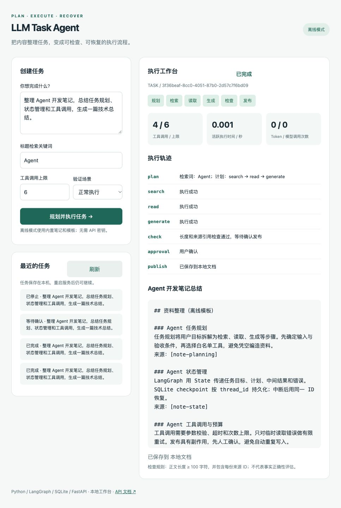
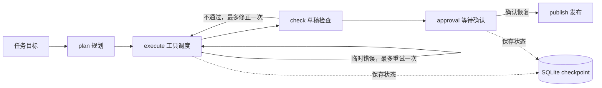

# LLM Task Agent

基于 Python、LangGraph 与 FastAPI 的内容整理 Agent，以 Notion 笔记管理为应用场景，将资料检索、正文读取、草稿生成、结果检查与确认发布组织为可追踪的多步骤工作流。

**技术栈：** Python · LangGraph · FastAPI · SQLite · LLM API · Notion API · Docker

[快速开始](#快速开始) · [工作流设计](#工作流设计) · [API 文档](#api-文档) · [测试与验证](#测试与验证)

## 工作台

工作台展示任务状态、工具调用记录、执行耗时与来源草稿。下图为离线模式完成内容整理并保存本地文档后的实际界面，指标保留工具调用次数、活跃执行耗时和 Token / 模型调用次数。



## 核心功能

| 功能 | 实现方式 |
| --- | --- |
| 工作流编排 | LangGraph 节点与条件边组织规划、执行、检查、确认和发布 |
| 任务状态管理 | State 传递目标、计划、来源资料、草稿、调用计数和错误信息 |
| 持久化与恢复 | SQLite 检查点保存任务状态，支持发布确认点的跨进程恢复 |
| 工具调用约束 | 校验步骤白名单与执行顺序，每次尝试计入调用预算 |
| 有限重试与修正 | 临时读取或生成错误最多重试一次；草稿检查失败最多修正一次 |
| 发布控制 | 用户确认后保存本地文档，或创建 Notion 子页面 |
| API 服务 | 提供任务创建、状态查询、确认恢复与健康检查接口 |

## 快速开始

环境要求：Python 3.12。

```bash
git clone https://github.com/XinzheGao/llm-task-agent.git
cd llm-task-agent
python3.12 -m venv .venv
source .venv/bin/activate
pip install -r requirements.lock.txt
python -m uvicorn app.main:app --host 127.0.0.1 --port 8000
```

启动后访问 [工作台](http://127.0.0.1:8000) 或 [Swagger UI](http://127.0.0.1:8000/docs)。以上地址均为本机服务地址。

### 运行模式

| 模式 | 资料与生成方式 | 输出位置 |
| --- | --- | --- |
| `demo`（默认） | 内置笔记、固定计划与模板整理，无需密钥 | 本地 SQLite 文档表 |
| `live` | LLM 生成受限计划与草稿，通过 Notion API 检索和读取资料 | 确认后创建 Notion 子页面 |

真实接口适配器已通过模拟 HTTP 契约测试，真实 LLM / Notion 账号联调待完成。下文截图与固定场景结果来自离线模式。

### 操作流程

1. 输入整理目标，使用标题检索词 `Agent` 和默认调用上限 `6` 创建任务。
2. 查看执行轨迹、来源草稿和调用计数。检查通过后，任务进入“等待确认”。
3. 确认发布，或重启服务后从历史任务重新打开，再继续执行。
4. 切换验证场景，检查首次检索超时、草稿修正和预算耗尽时的处理结果。

## 工作流设计



执行层按 `search → read → generate` 调度工具。真实模式通过 `plan_workflow` function schema 接收模型提交的检索词、标题和步骤，并在服务端校验。当前规划范围限定为内容整理流程。

草稿检查要求正文不少于 100 字符，并包含每份来源的 ID。该规则检查输出结构与引用覆盖，不承担语义或事实正确性判断。

### 发布确认与恢复

草稿通过检查后，`interrupt()` 暂停工作流。状态按任务对应的 `thread_id` 保存到 SQLite；服务重启后，以相同 ID 和 `Command(resume=...)` 继续。正常流程下，已经完成的检索、读取与生成不会重复执行。

<details>
<summary>查看发布确认界面</summary>


</details>

### 调用预算

工具调用前检查剩余预算，失败重试同样消耗调用次数。下例将上限设为 `1`：完成检索后停止，不继续读取、生成或发布。

<details>
<summary>查看预算耗尽后的任务状态</summary>


</details>

## API 文档

Swagger UI 提供请求参数、数据结构和响应说明。展开接口后，可通过 **Try it out → Execute** 发起请求。


| 方法 | 路径 | 用途 |
| --- | --- | --- |
| `POST` | `/api/tasks` | 创建并执行任务 |
| `GET` | `/api/tasks` | 查询最近 30 个任务 |
| `GET` | `/api/tasks/{task_id}` | 查询状态、轨迹、草稿与调用指标 |
| `POST` | `/api/tasks/{task_id}/resume` | 确认发布或取消任务 |
| `GET` | `/api/health` | 查询服务状态与运行模式 |

创建任务：

```bash
curl -X POST http://127.0.0.1:8000/api/tasks \
  -H 'Content-Type: application/json' \
  -d '{"goal":"整理 Agent 开发笔记","query":"Agent","max_tool_calls":6}'
```

从响应复制 `task_id`，查询任务或确认恢复：

```bash
curl http://127.0.0.1:8000/api/tasks/任务ID

curl -X POST http://127.0.0.1:8000/api/tasks/任务ID/resume \
  -H 'Content-Type: application/json' \
  -d '{"approved":true}'
```

`approved:false` 取消发布；真实模式下，`true` 将触发 Notion 写入。无效输入返回 `422`，未知任务返回 `404`，重复恢复已结束任务返回 `409`。请求同步执行，轨迹在响应后展示。

## LLM 与 Notion 配置

复制环境变量模板，填写配置后重启服务：

```bash
cp .env.example .env
```

```dotenv
AGENT_MODE=live
LLM_BASE_URL=https://api.openai.com/v1
LLM_API_KEY=你的密钥
LLM_MODEL=支持工具调用的模型名称
NOTION_TOKEN=你的集成密钥
NOTION_PARENT_PAGE_ID=普通父页面ID
```

LLM 服务需兼容 Chat Completions 与 `tool_choice`。在 Notion 中，将源页面和目标父页面授权给集成，并提供读取与创建内容权限。发布时在指定父页面下创建子页面，正文以纯文本段落保存。

当前检索最多返回 3 页，每页读取前 100 个顶层块，正文最多保留 12000 字符；不递归读取子块。API 版本固定为 `2022-06-28`，使用普通页面接口。运行失败时不会自动切换为离线模式。

## 测试与验证

```bash
python -m pytest -q
python -m evaluation.run
```

| 验证项 | 结果 | 覆盖范围 |
| --- | --- | --- |
| 自动化测试 | 12 项通过 | 状态恢复、重复发布拦截、有限重试与修正、预算限制、API、模拟 HTTP 契约 |
| 正向固定场景 | 3 / 3 完成 | 正常整理、临时检索超时、首次草稿不合格 |
| 异常固定场景 | 3 / 3 按预期停止 | 无匹配来源、工具预算耗尽、发布前预算耗尽 |

固定场景与本机运行记录见 [evaluation/cases.json](evaluation/cases.json) 和 [evaluation/results.json](evaluation/results.json)。这些结果验证工作流行为，不衡量真实模型生成质量。

`tool_calls` 统计逻辑工具执行尝试，包含生成与失败重试；一次读取工具最多产生 3 次 Notion HTTP 请求。规划模型调用单独计入 `llm_calls`。`active_seconds` 统计节点内的活跃执行时间，排除人工等待；评测另记录端到端耗时。

## Docker

```bash
docker compose up --build
```

Compose 使用 Python 3.12、单工作进程与命名卷 `agent-data`，默认仅绑定本机 8000 端口，并从 `.env` 读取配置。Docker 构建尚未验证。

## 当前边界

- 服务面向本地单用户使用，任务同步串行执行，未提供用户认证。
- 恢复 API 覆盖发布确认中断点；暂未提供任意崩溃位置的自动续跑入口。
- 发布记录按 `task_id` 缓存，拦截正常流程中的重复发布；远端写入与本地记录之间没有跨系统原子事务。
- 发布超时后，远端结果可能不确定，服务停止并提示核对，不自动重试写入。

## 项目结构

```text
app/
  agent.py           LangGraph 工作流与任务状态
  providers.py       离线资料、LLM 与 Notion 适配器
  main.py            FastAPI 接口
  static/index.html  可视化工作台
docs/images/         界面截图
evaluation/          固定场景、评测脚本与结果
tests/               工作流、接口与契约测试
Dockerfile           容器构建配置
compose.yaml         本地容器运行配置
```

更多操作说明见 [使用与架构说明](DEMO_GUIDE.md)。技术参考：[LangGraph 持久化](https://docs.langchain.com/oss/python/langgraph/persistence)、[中断与恢复](https://docs.langchain.com/oss/python/langgraph/interrupts)、[Notion 标题检索](https://developers.notion.com/reference/post-search)。
