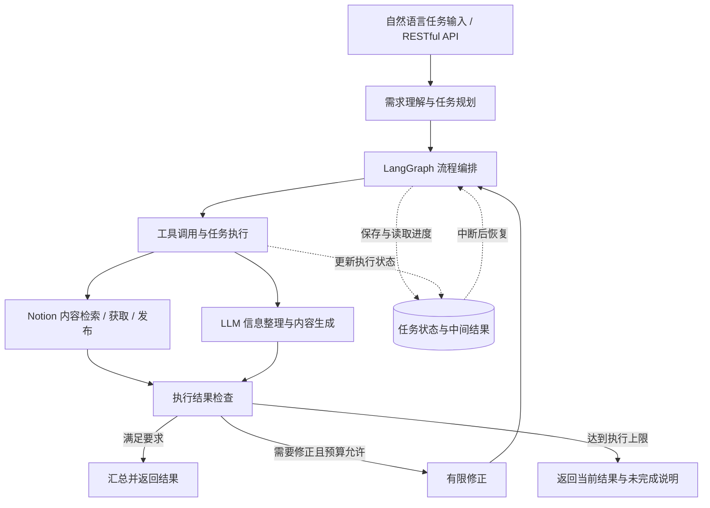

# 基于大语言模型的智能 Agent 系统

**LLM Task Agent** · 自然语言任务处理与 Notion 内容管理

基于 Python、LangGraph 和大语言模型 API 的任务驱动型智能 Agent，围绕“理解用户需求 → 拆解任务 → 调用工具 → 执行任务 → 检查结果 → 汇总输出”组织多步骤任务，以 Notion 内容管理为应用场景，实现内容检索、信息整理、内容生成与发布。

> **仓库状态：源码待上传。** 当前仓库先发布项目说明，源码、运行配置与评测材料将随后补充。下文按项目介绍说明功能与设计；具体实现细节和运行方式以之后上传的代码为准。

| 项目信息 | 内容 |
| --- | --- |
| 开发时间 | 2026 年 2 月至今 |
| 担任角色 | 开发者 |
| 技术栈 | Python、LangGraph、LLM API、Notion API、RESTful API、Docker |
| 应用场景 | 自然语言任务处理、Notion 内容管理 |

## 项目背景

内容管理任务通常包含检索资料、整理信息、生成内容和发布结果等多个步骤。单次模型调用难以管理整个执行过程，工具异常或任务中断也可能导致进度丢失与重复操作。

本项目通过任务规划、工具封装和执行状态管理，将自然语言需求组织为可执行的工作流，并通过状态持久化、中断恢复、结果校验和执行预算限制，提高多步骤任务的执行可靠性。

## 核心能力

### 1. 任务规划与流程编排

基于 LangGraph 编排任务规划与工具调用流程，将用户的自然语言需求拆解为可执行的子任务，并根据各步骤的执行结果组织后续操作。

### 2. 工具集成与内容处理

集成 Notion API，将内容检索、获取和发布等操作封装为 Agent 可调用的工具。结合大语言模型完成信息整理与内容生成，形成从需求输入到内容发布的工作流。

### 3. 上下文管理与中断恢复

管理任务执行过程中的上下文和状态，持久化保存任务进度与中间结果，支持任务中断后的恢复执行，并将已获得的信息传递给后续步骤。

### 4. 结果校验与执行约束

检查执行结果是否满足任务要求，对不符合要求的结果进行有限修正。设置重试次数和工具调用量上限，约束反复执行与外部调用成本。

### 5. API 服务与容器化部署

通过 RESTful API 对外提供任务调用与结果返回能力，使用 Docker 完成容器化部署，保持开发与运行环境的一致性。

### 6. 评测与可靠性验证

使用固定任务评测集覆盖多步骤内容处理、工具调用异常和任务中断恢复等场景，记录任务完成情况、执行耗时与模型调用成本，为后续迭代提供可比较的依据。

## 工作流程

以下为逻辑流程示意；具体节点、状态结构和存储方案随源码一同补充。

## 使用场景

**任务示例：**

> 检索 Notion 中与 Agent 开发相关的笔记，整理任务规划、工具调用和状态管理的要点，生成一篇技术总结，并发布到指定的 Notion 页面。

**执行过程示意：**

1. 解析检索范围、内容要求和发布位置。
2. 拆解检索、获取、整理、生成、检查和发布等子任务。
3. 调用 Notion 工具获取相关内容，并将结果传递给后续步骤。
4. 结合检索结果生成技术总结，检查内容是否满足任务要求。
5. 在执行预算内进行必要修正，完成发布并汇总执行结果。

该示例用于说明应用场景，实际运行记录与演示将在代码上传后补充。

## 技术栈

| 技术 | 用途 |
| --- | --- |
| Python | Agent 核心逻辑、工具封装与服务开发 |
| LangGraph | 多步骤任务编排、上下文与执行状态管理 |
| LLM API | 需求理解、任务规划、信息整理与内容生成 |
| Notion API | 内容检索、获取与发布 |
| RESTful API | 对外提供任务调用与结果返回能力 |
| Docker | 容器化部署与运行环境管理 |

## 评测与可靠性

固定任务评测集围绕以下场景组织：

| 场景 | 验证重点 |
| --- | --- |
| 多步骤内容处理 | 检索、整理、生成与发布流程是否满足任务要求 |
| 工具调用异常 | 异常处理、有限重试与失败结果返回 |
| 任务中断恢复 | 任务进度和中间结果是否可恢复并用于继续执行 |
| 结果不满足要求 | 结果校验与有限修正是否有效 |
| 执行预算耗尽 | 重试次数与工具调用量上限是否生效 |

评测记录包括：

- **任务完成情况与完成率**：依据固定任务的验收条件记录是否完成，并统计整体完成率。
- **执行耗时**：记录任务从开始到结束的耗时。
- **模型调用成本**：记录模型调用次数、Token 用量及对应成本。

具体评测集、指标口径、运行环境和结果数据将在评测材料上传后公布。

## 代码与运行说明

当前仓库尚未提供实现代码，暂不提供安装或启动命令。源码上传后将补充：

- 项目目录结构与模块说明。
- 依赖安装、环境变量和 Notion 集成配置。
- RESTful API 调用示例。
- 本地运行与 Docker 部署步骤。
- 任务中断恢复示例、固定评测集与评测结果。
